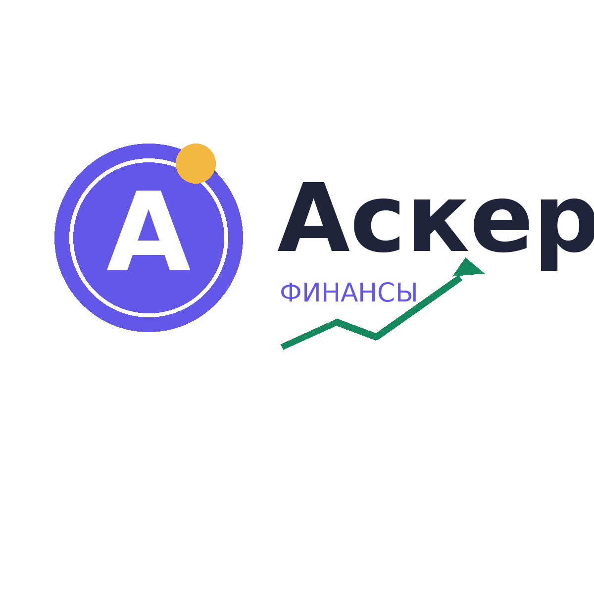

<!DOCTYPE html>
<html lang="ru">
<head>
  <meta charset="UTF-8">
  <meta name="viewport" content="width=device-width, initial-scale=1.0">
  <title>Аскер — Мои расходы</title>

  <link rel="icon" type="image/png" href="asker-logo.png">
  <link rel="apple-touch-icon" href="asker-logo.png">

  
</head>
<body>
  <main class="container">
    <header>
      

        
        
Простой контроль личных финансов

      

      

        <input id="monthFilter" class="month-input" type="month" aria-label="Выбрать месяц">
        <button id="settingsButton" class="secondary">Настроить</button>
      

    </header>

    <section class="grid">
      

        
Доходы за месяц

        
0 ₽

      

      

        
Расходы за месяц

        
0 ₽

      

      

        
Остаток за месяц

        
0 ₽

      

    </section>

    <section class="content-grid">
      

        <h2>Добавить операцию</h2>
        <form id="transactionForm">
          

            

              <label for="type">Тип операции</label>
              <select id="type">
                <option value="expense">Расход</option>
                <option value="income">Доход</option>
              </select>
            

            

              <label for="amount">Сумма, ₽</label>
              <input id="amount" type="number" min="1" step="0.01" placeholder="Например, 1500" required>
            

            

              <label for="category">Категория</label>
              <select id="category"></select>
            

            

              <label for="date">Дата</label>
              <input id="date" type="date" required>
            

            

              <label for="description">Комментарий (необязательно)</label>
              <input id="description" type="text" maxlength="80" placeholder="Например, продукты на неделю">
            

          

          <button class="primary form-submit" type="submit">Добавить операцию</button>
        </form>
      

      

        <h2>Расходы по категориям (диаграмма)</h2>
        

          <canvas id="pieChart"></canvas>
        

        

      

      

        <h2>Операции за выбранный месяц</h2>
        

      

    </section>
  </main>

  

    <section class="modal" role="dialog" aria-modal="true" aria-labelledby="setupTitle">
      <h2 id="setupTitle">Настроим приложение</h2>
      
Отметь, какие расходы относятся к твоей жизни. Их категории появятся в списке операций. Можно изменить выбор позже.

      

        <label class="check"><input type="checkbox" value="rent"> Снимаю жильё</label>
        <label class="check"><input type="checkbox" value="car"> Есть автомобиль</label>
        <label class="check"><input type="checkbox" value="children"> Есть дети</label>
        <label class="check"><input type="checkbox" value="pets"> Есть питомцы</label>
        <label class="check"><input type="checkbox" value="subscriptions"> Есть подписки</label>
      

      

        <button id="saveSetup" class="primary">Сохранить настройки</button>
      

      
Данные хранятся только в этом браузере на твоём устройстве.

    </section>
  

  
</body>
</html>
